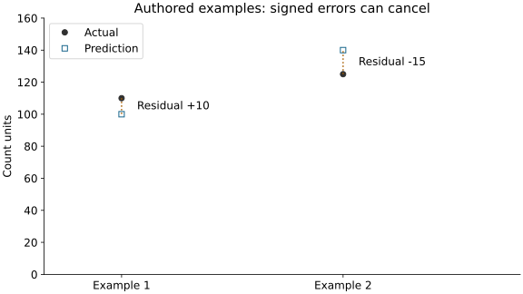

# Module 5: from a prediction to a defensible forecast

Use this after the [foundation bridge](foundation.md), then try the [guided construction](guided.md). This develops M05.1–M05.5 using arithmetic, a timeline and a small pipeline. Mathematical derivations are optional.

## 1. State the decision before choosing a model

An operations team asks how many requests to expect tomorrow. Define one row as a target day and issue the forecast after today's count is finalized. A number is useful only if the team can act on it: for example, arrange staffing or capacity. State the unit and the time zone before writing features.

For the historical bike example, the count is rentals, not server requests. Yesterday's finalized rentals can be an input. Tomorrow's observed rentals cannot. A calendar date may be known in advance; tomorrow's observed weather is not the same as a forecast issued today.

| Target day | Information available at the preceding day's end | Input allowed in this exercise |
| --- | --- | --- |
| Tuesday | Monday's finalized count: 100 | 100 |
| Wednesday | Tuesday's finalized count: 150 | 150 |
| Thursday | Wednesday's finalized count: not yet supplied in this hand example | Unavailable until that origin |

**Pause:** If Tuesday's count becomes an input to Wednesday's forecast, did we necessarily leak a holdout label? Explain when the answer depends on a rolling daily origin rather than a single batch forecast issued on Monday.

## 2. Follow one prediction through the model

Use the authored rule `prediction = 20 + 0.8 * yesterday_count`. At 100 it predicts 100; at 150 it predicts 140. The intercept adds a starting amount. The coefficient changes predicted count units when the input increases by one. These chosen values illustrate inference; a fitted pipeline estimates its own coefficients from training data.

Fitting and prediction are different operations. In fitting, historical inputs and their known targets determine parameters. In prediction, a fixed model receives inputs and returns an estimate without knowing the new target. A fitted coefficient describes an association under the chosen data and model, not a causal effect.

## 3. Separate error direction from error size

Predict the residual sign before reading this table. Our convention is **actual minus predicted**.

| Authored example | Actual | Predicted | Residual | Absolute error | Squared error |
| --- | --- | --- | --- | --- | --- |
| 1 | 110 | 100 | +10 | 10 | 100 |
| 2 | 125 | 140 | -15 | 15 | 225 |

Positive means underprediction here. The average residual is -2.5, while MAE is 12.5. Signed errors cancel; their sizes do not. MSE is 162.5 squared count units. A small mean residual can therefore coexist with substantial individual mistakes.

Ordinary least squares fits using squared training errors. This module compares forecasts using held-out absolute errors because their units are easy to explain. Those choices need not be identical. MAE is an observed average, not a maximum or a promise about tomorrow.

**Try changed inputs:** Increase the second actual value from 125 to 155. Which residual changes sign? Does a sign change alone tell you that MAE increased? Calculate before running.

## 4. Give a baseline a fair chance

A training-mean baseline ignores today's input and predicts the mean learned from training targets. Previous-day persistence predicts the previous observed count. A learned regression estimates relationships between valid lag inputs and the target.

All candidates must answer the same forecast question on the same validation targets. A baseline that sees future actuals and a regression that does not are not comparable. A trained model also does not earn preference just by being more complex.

In the practice notebook, write the lag yourself, then fit a median-imputer/linear-regression pipeline. The bounded sandbox uses the first 81 source dates: seven lag warm-up days, 60 training targets and 14 validation targets. It is separate from the complete study and uses no final-test score for a decision.

## 5. Understand what the pipeline learns

Training inputs `[1, 3, missing, 5]` have median 3. A median imputer fills the missing value with 3. A later input of 100 must not change that fitted median. If you combine training and later inputs before fitting the imputer, information crosses the boundary even though the regression itself sees only training labels.

Write the stages in words: training fits the imputer and regression; validation inputs pass through those fixed transformations; validation errors compare the declared candidates; the selected rule is frozen; final testing evaluates that rule. A pipeline helps keep transformations consistent, but cannot decide whether your input was available at the forecast origin.

## 6. Explain an operational recommendation

Use the actual comparison table to write: task and origin → baseline → selected validation criterion → one observed error → decision and limitation. If staffing costs differ for over- and underprediction, name that unanswered cost question instead of calling MAE a staffing policy.

For an IT transfer, propose a daily support-ticket forecast. State the ticket counting rule, when a day is complete, one available lag, one tempting unavailable field and what the team does if the forecast is missing. This is a design exercise, not evidence from real ticket records.

## Optional open mathematical depth

- [Dive into Deep Learning: linear regression](https://d2l.ai/chapter_linear-regression/linear-regression.html): read the model and squared-loss explanation; parameter-estimation derivations are optional.
- [scikit-learn regression metrics](https://scikit-learn.org/1.8/modules/model_evaluation.html#regression-metrics): compare MAE and squared-error definitions with the hand calculation.

The explanations and hand examples on this page are original. External readings provide additional depth; you do not need to reproduce their proofs to complete the existing module outcomes.

Continue to [guided construction](guided.md), [practice](practice.md), then [feedback](feedback.md) and the [complete reference study](index.md#run-distinct-stages).
