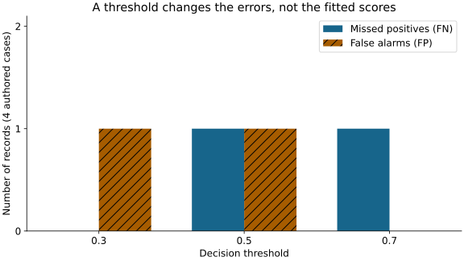

# Module 6: from a score to a decision

Use the [foundation bridge](foundation.md), this explanation, [guided construction](guided.md), then [practice](practice.md). These activities support the existing M06.1–M06.5 outcomes. You need arithmetic and array comparisons, not calculus.

## 1. Define what a positive label means

A classifier's positive class is a declared target, not a compliment. In this module, positive means a wine rating of at least seven. It does not mean safe, certified or suitable for a particular use. In an IT task, positive might mean an incident that requires investigation; that would need its own label definition and permitted records.

The fitted classifier produces a positive-class score. A threshold converts it into a decision. Here a score **equal to or above** the threshold is positive. Training a new model changes its score function; changing the threshold can change decisions without fitting new weights.

## 2. Trace the four possible outcomes

Before reading the outcome column, apply threshold 0.5 to these four authored records.

| Record | Actual label | Positive-class score | Decision at 0.5 | Outcome |
| --- | --- | --- | --- | --- |
| A | 0 | 0.2 | Negative | TN |
| B | 1 | 0.4 | Negative | FN |
| C | 0 | 0.5 | Positive | FP |
| D | 1 | 0.8 | Positive | TP |

TP, FP, FN and TN sum to four because every record belongs to exactly one cell. Precision asks what fraction of positive decisions are actual positives: 1/2. Recall asks what fraction of actual positives were found: 1/2. Their values happen to agree here, but their denominators answer different questions.

**Change the question:** Add three negatives scored 0.1. Which metric's denominator changes? Compute accuracy and recall; explain why more easy negatives can improve accuracy without finding another positive.

## 3. Make the tradeoff visible

| Threshold | TP | FP | FN | TN | Cost if a miss costs 3 and a false alarm costs 1 |
| --- | --- | --- | --- | --- | --- |
| 0.3 | 2 | 1 | 0 | 1 | 1 |
| 0.5 | 1 | 1 | 1 | 1 | 4 |
| 0.7 | 1 | 0 | 1 | 2 | 3 |

At a 3:1 miss-to-false-alarm cost ratio, choose 0.3 from these candidates. At 1:5, choose 0.7. These costs are declared teaching assumptions, not measured dollars or a universal preference for recall. A real investigation queue also has capacity, time and accountability constraints.

Our practice function breaks equal total costs using the smallest threshold. A stable tie rule keeps repeated runs explainable. The complete reference study uses its documented validation criterion; the sandbox's illustrative cost rule does not silently replace it.

## 4. Fit preprocessing before selecting a decision

The practice pipeline has a scaler followed by logistic regression. The scaler learns means and scales from training rows. The classifier learns parameters from training features and labels. Validation rows are transformed with those fixed training quantities; their labels evaluate candidate thresholds.

For training inputs `[0, 2, 4, 6]`, the mean is 3. A new input of 100 must not move it. A pipeline trained after stacking validation rows would violate that boundary. A pipeline trained correctly can still have an invalid label, unsuitable split or unavailable feature.

The probability column also needs a label check. `predict_proba` returns a column per fitted class. Find the column corresponding to class 1; do not assume column zero is the positive class or confuse a probability with the hard prediction returned by `predict`.

## 5. Connect a logistic model and a tree to the same question

Logistic regression combines scaled inputs into a score and maps it into a probability. A tree routes a row through feature comparisons to a leaf. The shallow tree rules in the complete reference let you trace an actual row: identify the feature, comparison and chosen branch at every step, then reconcile the leaf prediction with its observed label.

Depth changes how many distinctions a tree can make. More depth may fit training records better while performing worse on validation. A predictive importance or a split on a feature does not establish that changing the feature would cause the outcome to change.

## 6. Preserve the final evaluation boundary

In the real development sandbox, use the course's grouped training and validation partitions. Fit the classifier and compare it with a training-prior baseline. Choose each method's threshold using the same candidate set and declared cost rule. Keep all candidate counts visible, not only the preferred score. Final labels do not participate.

For the complete study, retain its fixed model/threshold rule and evaluate the frozen choice as instructed. Once you have seen a public final report, a rerun is a reproduction exercise; making another directory does not create new unseen data.

## Check yourself

Answer each question before opening its explanation.

1. At threshold 0.5, an actual negative scores exactly 0.5. Which outcome is it?

A false positive: in this course a score equal to or above the threshold is predicted positive.

2. With TP 19, FP 30 and FN 10, what are precision and recall?

Precision is 19/49, about 0.39; recall is 19/29, about 0.66. They answer different questions and use different denominators.

3. You add many easy negatives to the evaluation set. Which of accuracy and recall changes?

Accuracy can rise because its denominator grows with correct negatives; recall is unchanged because no new positive was found.

## Optional open mathematical depth

- [scikit-learn classification metrics](https://scikit-learn.org/1.8/modules/model_evaluation.html#classification-metrics): compare the confusion-matrix, precision and recall definitions with the four-record example.
- [Dive into Deep Learning: classification](https://d2l.ai/chapter_linear-classification/softmax-regression.html): optional reading on scores, probabilities and cross-entropy. Its multiclass derivations go beyond the arithmetic required here.
- [UBC CPSC 330 generalization lesson](https://ubc-cs.github.io/cpsc330-2024W1/lectures/notes/03_ml-fundamentals.html): optional alternative explanation of tree depth and generalization. This page uses original examples and does not reproduce that course's materials.

Continue to [guided construction](guided.md) and [practice](practice.md). Use [feedback](feedback.md) after your first attempt.
