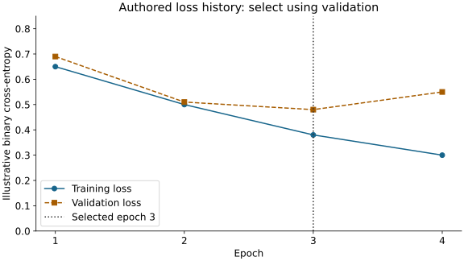

# Module 8: understand one update before training a network

This applied explanation supports M08.1–M08.5. Start with the [foundation bridge](foundation.md), then use [guided construction](guided.md) and [practice](practice.md). Deriving backpropagation is optional; explaining inputs, loss, an update and evaluation boundaries is central.

## 1. Follow one observation through the model

Start with two illustrative input values, not the full wine dataset. For inputs `[1, 2]`, weights `[0.5, -1]` and bias `0.5`, the weighted sum is `1*0.5 + 2*(-1) + 0.5 = -1`. ReLU replaces a negative hidden value with zero. A sigmoid maps an output value into the interval zero to one; a probability still requires an evaluation context and a decision rule.

In a hidden layer there is one weight vector and bias for each hidden unit. A batch stores several observations as rows. A matrix multiplication applies the same learned weights to every row; it does not combine all observations into a single prediction.

| Stage in the complete module network | Shape for a batch of 32 | Meaning |
| --- | --- | --- |
| Scaled chemistry inputs | (32, 11) | 32 observations, 11 input features each |
| Hidden ReLU activations | (32, 16) | 16 hidden values for each observation |
| Output sigmoid probabilities | (32, 1) | One positive-class probability per observation |

The hidden layer has `11*16 + 16` parameters. The output has `16*1 + 1`, for 209 total. Changing batch size does not change this count. Changing hidden width does. The practice check repeats construction at two sizes so a hard-coded 209 is insufficient.

## 2. Connect a mistake to a training update

For a known positive label, a probability near zero incurs more binary cross-entropy than a probability near one. For a known negative, the reverse holds. The objective encourages the model to assign probability to the observed labels; it is not a direct count of false alarms at your later chosen threshold.

In the guided single-output example, `p - y` tells the direction of the weight correction after accounting for the input. With `p` about 0.269 and `y=1`, the error term is negative. Subtracting a small multiple of the gradient moves the chosen weights toward a higher positive-class score. Run the supplied step and compare the probability and loss before and after the update.

This explains one logistic-output update, not the entire hidden-layer derivative. TensorFlow's `GradientTape` computes derivatives through the full network. You remain responsible for which rows and labels enter that computation. A larger step is not automatically better, and one successful step does not guarantee convergence or generalization.

## 3. Read the training loop as decisions

For each training batch: compute predictions → compute loss from training labels → differentiate with respect to trainable weights → apply an optimizer update. An epoch is one pass through the chosen training rows. Validation is a separate evaluation pass with no optimizer update.

Fit numeric preprocessing using training features only. Validation means and final labels must not alter the fitted scaler or the gradient objective. The small development sandbox uses at most 256 training and 64 validation observations, eight epochs and width eight. Those bounds expose mechanics on CPU; they are not the complete module benchmark or evidence of optimal architecture.

## 4. Select a checkpoint using the right evidence

Predict which epoch to retain before reading the selection column. These values are authored to illustrate the decision, not measured results from the course network.

| Epoch | Training loss | Validation loss | Selection implication |
| --- | --- | --- | --- |
| 1 | 0.65 | 0.69 | First candidate |
| 2 | 0.50 | 0.51 | Better validation loss |
| 3 | 0.38 | 0.48 | Best validation loss |
| 4 | 0.30 | 0.55 | Lower training loss, worse validation loss |

Retain epoch 3 under the declared minimum-validation-loss rule, with the earliest epoch winning a tie. Validation chooses the checkpoint; the final test evaluates a frozen choice. A real short training run may never display this pattern. Do not invent overfitting merely because the lesson discusses it.

## 5. Verify replay and compare usefulness separately

The sandbox restores the selected weights, saves the network and reloads it. Matching probabilities answer a serialization question: did saving and loading preserve this model's predictions? They do not answer whether its decisions are useful.

Continue to the complete study for the logistic baseline, separately validation-selected decision thresholds, final confusion counts and compute evidence. A neural model can recover more positives while causing more false alarms than the simpler baseline. Explain both, using denominators and the operational question, rather than treating the larger model as the default winner.

For a hypothetical IT alert queue, state the observation unit and when inputs become available. Ask whether a high-recall setting creates an investigation workload the team can handle. Chemistry labels are not actual alert labels; genuine IT performance needs appropriate records and evaluation.

## Optional open mathematical depth

- [Dive into Deep Learning: multilayer perceptrons](https://d2l.ai/chapter_multilayer-perceptrons/mlp.html): layers, hidden activations and capacity.
- [Dive into Deep Learning: forward/backward propagation](https://d2l.ai/chapter_multilayer-perceptrons/backprop.html): optional chain-rule and computational-graph derivation.
- [TensorFlow automatic differentiation](https://www.tensorflow.org/guide/autodiff): trace the role of `GradientTape`; start with the basic gradient example, not every advanced case.

Readings extend the original explanation; completing formal proofs is not an added requirement. Continue to [guided construction](guided.md), [practice](practice.md), then [feedback](feedback.md) and the [complete study](index.md).
